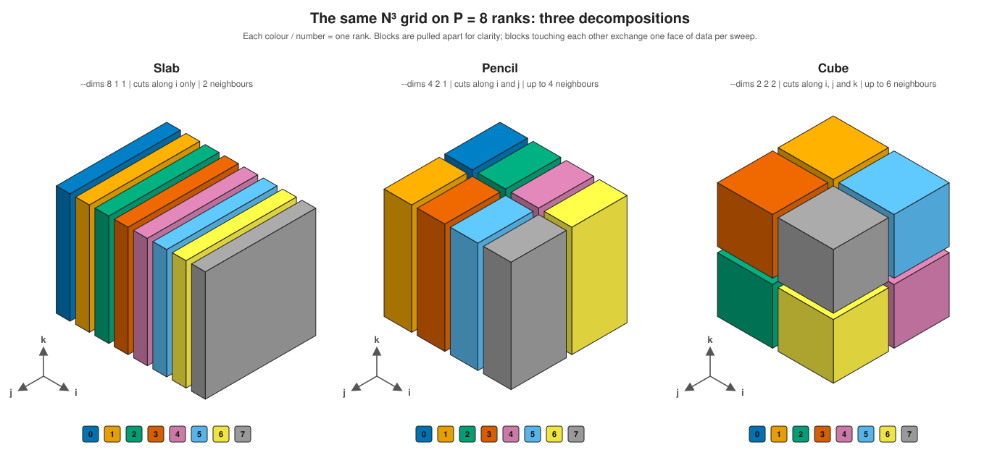
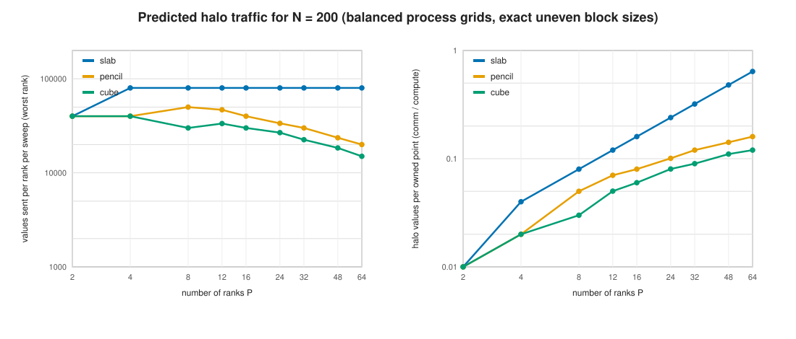
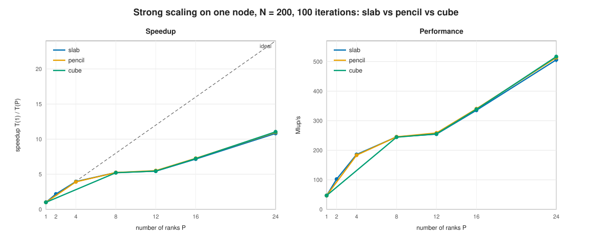
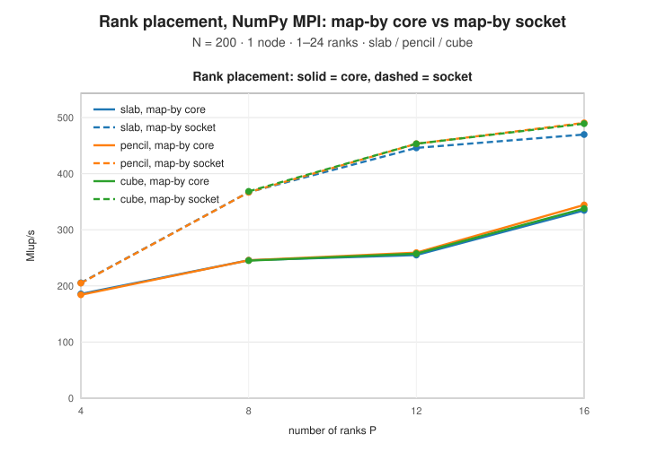
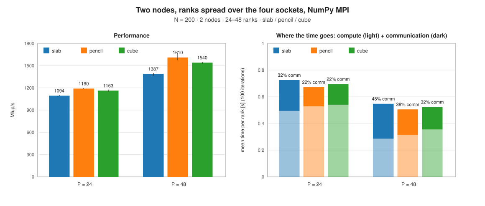

# Report section: domain decomposition geometries (slab, pencil, cube)

Draft for the report. All numbers come from `results/*.csv` (N = 200, 100 Jacobi iterations, `--tol 0`, Intel Xeon E5-2650 v4, 2 sockets x 12 cores per node, `hpcintro` queue, ranks pinned with `--bind-to core`). Points are the mean of 3 repetitions unless noted; the repetition spread is below 2 % except where stated. Figures are in `plots/`.

## 1. Question and approach

The assignment asks for different domain decompositions of the 3D grid using a Cartesian process map. We compare three layouts of P ranks, all produced by the same code (`main_mpi_cart.py`, `poisson/decomposition.py`) with a process grid `--dims Px Py Pz`:

- **slab** (P x 1 x 1): cuts along i only; each rank has 2 neighbours
- **pencil** (Px x Py x 1): cuts along i and j; up to 4 neighbours
- **cube** (Px x Py x Pz): cuts along all axes; up to 6 neighbours

Each rank holds its block plus one ghost layer per side; before every sweep it exchanges the faces with its neighbours (`MPI_Sendrecv` per axis and direction). The i-faces are contiguous in memory (C order); j- and k-faces are strided and are copied into contiguous buffers before sending.



## 2. Expectations (written before the experiments)

Computation per rank scales with the volume N^3/P of its block, communication with the area of its faces. For a balanced process grid, the values sent per rank per sweep and the ratio to the owned points are:

| layout | halo values per sweep | halo / owned point | N=200, P=24 | N=200, P=48 |
|---|---|---|---|---|
| slab | 2 N^2 (independent of P) | 2P/N | 0.24 | 0.48 |
| pencil | about 4 N^2 / sqrt(P) | 4 sqrt(P)/N | about 0.10 | about 0.14 |
| cube | about 6 N^2 / P^(2/3) | 6 P^(1/3)/N | about 0.09 | about 0.11 |

(The last two columns use the actual process grids of the runs: 6x4x1 / 4x3x2 at P=24, 8x6x1 / 4x4x3 at P=48.)



Hypotheses:

1. The slab communicates the most per point and falls behind at large P; the cube communicates the least.
2. The cube pays for this with more messages (6 instead of 2) and packing of strided faces, so its advantage may be smaller than the volume argument suggests.
3. Jacobi is memory-bandwidth bound (about 0.125 flop per byte), so on one node the ranks compete for memory bandwidth; this should limit scaling more than MPI does.
4. Rank placement (which ranks share a socket's memory controller) can matter as much as the geometry.

## 3. Correctness

The result must not depend on the layout. For N=30 all layouts give 680 iterations and max error 3.42e-03, and for N=31 (not divisible by most process grids) 724 iterations and 3.22e-03, identical to the sequential and the slab solver. Tested: 1x1x1, 6x1x1, 2x3x1, 3x2x1, 1x2x3, 2x2x3, 2x2x2, 1x1x4. A separate halo-exchange test checked every ghost value for several grids including uneven splits. In all timing runs (100 iterations, not converged) the max error is identical across layouts (0.952).

## 4. Results

### 4.1 One node, ranks filled core by core (`--map-by core`)



Single rank: 46.5 Mlup/s. At 24 ranks: slab 506, pencil 514, cube 517 Mlup/s, i.e. a speedup of about 11 (efficiency about 46 %). The three layouts are within 1-3 % of each other at every P (spread between repetitions about 1 %). Between 8 and 12 ranks the performance is flat (about 245 -> 255 Mlup/s).

### 4.2 Rank placement matters more than geometry (one node)



| P | map-by core (fills socket 0 first) | map-by socket (alternates sockets) |
|---|---|---|
| 4 | 185 | 205 |
| 8 | 245 | 367 |
| 12 | 255 | 450 |
| 16 | 335 | 470-490 |

With `--map-by core`, 8 ranks sit on one socket and share its memory bandwidth; spreading them over both sockets gives about +50 % at P=8 and about +75 % at P=12 (same layouts, same code). This explains the plateau between 8 and 12 ranks in 4.1. At P=16 with socket mapping the slab is about 4 % behind pencil and cube (470 vs 490); otherwise the layouts are equal within about 1 %.

### 4.3 Two nodes, ranks spread evenly over the four sockets

Two nodes (2 x 24 cores), 6 ranks per socket at P=24 and 12 per socket at P=48 (`jobs/mpi_socket2n.sub`).



| P | slab | pencil | cube |
|---|---|---|---|
| 24 | 1094 | 1190 | 1163 |
| 48 | 1387 | 1610 | 1540 |

Relative to the single rank this is a speedup of 25 / 26 / 25 at P=24 and 30 / 35 / 33 at P=48 (best efficiency 72 % at P=48). Here the layouts separate: the slab is 8 % behind the best at P=24 and 14 % behind at P=48. Pencil and cube are within 4-5 % of each other, with the pencil ahead.

Per-rank time split (first repetition, mean over ranks, N=200). "Communication" includes waiting for neighbours.

| layout | P | compute [s] | communication [s] | comm share |
|---|---|---|---|---|
| slab | 24 | 0.494 | 0.231 | 32 % |
| pencil | 24 | 0.527 | 0.145 | 22 % |
| cube | 24 | 0.540 | 0.155 | 22 % |
| slab | 48 | 0.285 | 0.262 | 48 % |
| pencil | 48 | 0.313 | 0.192 | 38 % |
| cube | 48 | 0.355 | 0.169 | 32 % |

## 5. Discussion

**Hypothesis 1 (slab falls behind, cube communicates least): supported, but only when the network is involved and the node's memory bandwidth is not the limit.** On a single node with core mapping (4.1) the three layouts are equal within a few percent because the compute is bandwidth-limited and shared-memory messages are cheap. With ranks spread over four sockets and two nodes (4.3) the slab spends the largest share of its time communicating (48 % at P=48 against 38 % and 32 %), and is 8-14 % slower. The communication time per rank follows the order of the predicted halo volume (slab > pencil > cube); the cube has the lowest communication time at P=48 (0.169 s against 0.192 s and 0.262 s).

**Hypothesis 2 (cube advantage reduced by overheads): partly supported, with a different cause than expected.** The cube communicates less than the pencil but is still slower at P=48 (1540 against 1610). The table shows why in these runs: its compute time per rank is higher (0.355 s against 0.313 s for the pencil and 0.285 s for the slab at P=48; the same ordering at P=24). This is the size of the difference in total time. A plausible reason is that the Jacobi kernel works on contiguous lines along k: the slab and pencil keep k complete (200 points), the cube cuts k into 66-67 points, which makes the inner loops shorter and the memory access less efficient. We have not tested this directly (it would need a run with the same block volume but different k-length), so it remains an explanation, not a result. Packing cost and message count (more messages for the cube) are part of its communication time, and the total is still lowest; so for our sizes they do not outweigh the smaller halo.

**Hypothesis 3 (memory bandwidth limits scaling): supported.** On one node, 8-12 ranks barely improve with core mapping, and spreading the ranks over both sockets gives +50 % to +75 % at the same P (4.2). The measured traffic under the course convention (64 bytes per update) at P=48 is 1610 Mlup/s = 103 GB/s, about 51 GB/s per node; we have not run STREAM, so we do not claim how close this is to the hardware limit.

**Hypothesis 4 (placement as important as geometry): supported, and stronger than expected.** Placement changed performance by up to a factor of 1.8 (P=12), geometry by at most 14 %. A fair comparison of layouts therefore needs the same placement; the geometry effect is visible only after the placement is chosen well (4.3).

**Practical conclusion for our sizes (N=200, up to 48 ranks):** use a decomposition that cuts at least two axes once communication starts to matter (P=24 or more, or when the network is involved); the pencil is the best or equal-best choice in all our measurements, the cube is close behind, and the slab is acceptable only at small P. Rank placement should be fixed first.

## 6. Limitations and open points

- One problem size for the main comparison (N=200). A run at N=300 and P=48 (included in `results/mpi_socket2n.csv`) had very large repetition spread (e.g. slab 378-940 Mlup/s) and cannot be used; the cause was not investigated (possibly interference from other jobs on the shared nodes or the network).
- 3 repetitions per point, in a few sessions on a shared cluster; the repetition spread is shown in the plots, but differences below about 3 % (for example pencil against cube at P=24) should not be over-interpreted.
- Process grids were chosen by hand (largest factor on axis 0); other grids with the same P (for example 1x1x4 is a slab along k) can perform differently: at N=30, P=4 a slab along k ran at 85 Mlup/s, against 126 Mlup/s along i. We did not scan grid shapes at N=200.
- The compute/communication split is from `MPI_Wtime` around the exchange and the kernel, first repetition only; communication includes waiting caused by imbalance (the uneven N/P split is at most one layer).
- No non-blocking communication or MPI derived datatypes (faces are packed by copies); overlap of communication and computation could shift the picture in favour of the cube/pencil.
- Hardware peak bandwidth comparison (STREAM) is still missing.

## 7. Reproduce

```
bsub < jobs/mpi_decomp.sub      # one node, slab/pencil/cube, core mapping   -> results/mpi_decomp*.csv
bsub < jobs/mpi_placement.sub   # core vs socket mapping                     -> results/mpi_placement_*.csv
bsub < jobs/mpi_multinode.sub   # two nodes, mapping per node (preliminary)  -> results/mpi_multinode.csv
bsub < jobs/mpi_socket2n.sub    # two nodes, spread over sockets, rank times -> results/mpi_socket2n*.csv
python3 plotting/plot_decomp_scaling.py        # SVG figures in plots/
python3 plotting/draw_decompositions.py        # layout / halo figures
```
