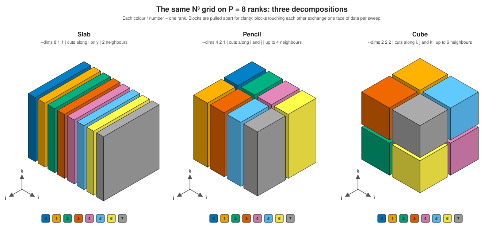
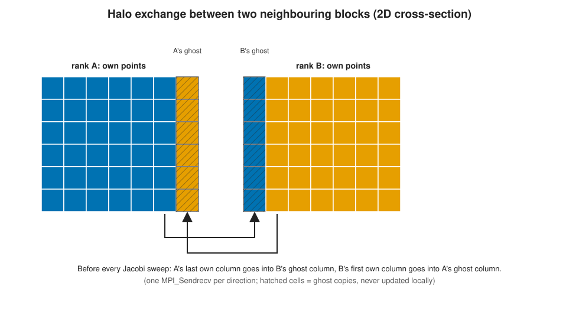
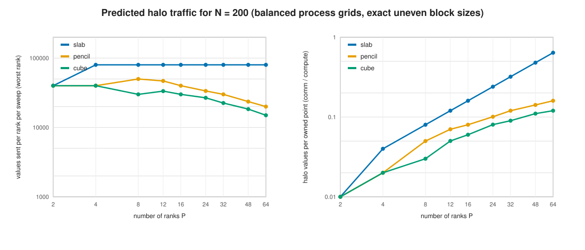

# Study guide: Poisson problem with MPI, and domain decompositions

Written for oral-exam preparation, focused on the decomposition part (slab / pencil / cube), but it explains the whole project from the ground up. Everything here refers to this repo. Statements about *measured* results are marked as such; statements about *predictions* are marked as hypotheses until the cluster experiments (plan step 6) have been run.

Figures (regenerate with `python3 plotting/draw_decompositions.py`, plain Python, writes SVG files that VS Code and GitHub display): `plots/decomposition_layouts.svg`, `plots/decomposition_halo.svg`, `plots/decomposition_halo_volume.svg`.

---

## 1. The problem we solve

**Poisson equation** in the cube [-1, 1]³:

    -∇²u = f   with u = 0 on the boundary (Dirichlet condition)

with the source term `f(x,y,z) = 3π² sin(πx) sin(πy) sin(πz)`. For this f the exact solution is known: `u = sin(πx) sin(πy) sin(πz)`. That is why we can measure the *error* of our numerical solution (`max_error` in `poisson/problem.py`).

**Discretisation.** Put a grid on the cube: N interior points per axis plus one boundary layer on each side, so arrays are (N+2)³ (see `docs/conventions.md`). Spacing Δ = 2/(N+1). Replace the second derivatives by finite differences (the **7-point stencil**): the Laplacian at point (i,j,k) uses the point itself and its 6 neighbours (±1 in i, j, k):

    (u[i-1,j,k] + u[i+1,j,k] + u[i,j-1,k] + u[i,j+1,k] + u[i,j,k-1] + u[i,j,k+1] - 6 u[i,j,k]) / Δ² = -f[i,j,k]

**Jacobi iteration.** Solve this equation for u[i,j,k] and use it as an update rule, taking all right-hand-side values from the *old* array:

    u_new[i,j,k] = 1/6 * (sum of 6 old neighbours + Δ² f[i,j,k])

Repeat until the change is small: stop when `‖u_new − u‖₂ < tol`. Key properties:
- Every point can be updated independently within one sweep (it only reads `u`, writes `u_new`). That is why Jacobi is easy to parallelise (Gauss-Seidel would not be).
- After each sweep the arrays are swapped (`u, u_new = u_new, u`), no copying. This is why both arrays need the boundary values from the start.
- It converges slowly (hundreds of iterations at N=30, more for larger N), but each sweep is simple. We study performance, not the best solver.

Code: `poisson/jacobi.py` (`jacobi_step`, `diff_sq`, `jacobi`).

**Correctness reference:** N=30 → 680 iterations, max error 3.42e-03. N=31 → 724 iterations, 3.22e-03. A parallel program that gives anything else is wrong. The error is dominated by discretisation (Δ²), not by the parallelism, so it must be *identical* for any number of ranks / layout.

**Memory layout** (important for halos): NumPy arrays are C-order (row-major). `u[i,j,k]`: the last index k is contiguous in memory, i is slowest. So a face `u[i0,:,:]` (fixed i) is one contiguous block; a face `u[:,j0,:]` is N+2 separate chunks; a face `u[:,:,k0]` consists of single values with stride (N+2). This decides how expensive it is to send each face.

---

## 2. Performance basics you need

- **Lattice update (lup):** one update of one grid point. A run does N³ × iterations lups.
- **Mlup/s** = N³ × iterations / time / 10⁶. Our main performance metric (`poisson/metrics.py`).
- **GB/s:** Mlup/s × 64 B / 1000. The 64 bytes are the course convention: 7 loads + 1 store of 8-byte doubles per update. It is an *estimate* (it ignores caches).
- **Memory-bound:** per update we do ~8 flops but move ~64 bytes. The arithmetic intensity (~0.125 flop/B) is far below what the CPU can do, so the speed is limited by **memory bandwidth**, not by the floating-point units. Consequence: adding cores helps only until the memory controllers are saturated. In our slab results the speed barely grows from 8 to 12 ranks; that is probably bandwidth saturation of one socket, not MPI cost (hypothesis, consistent with the plan's hardware notes).
- **Cache effect:** when the arrays fit in cache (small N) Mlup/s is higher; see `plots/baseline_performance.png` with the cache sizes marked.
- **Strong scaling:** fixed problem size N, increase the number of ranks P. **Speedup** S(P) = T(1)/T(P). **Efficiency** E(P) = S(P)/P. Ideal: S = P, E = 1. **Weak scaling** (not used here): the work per rank is fixed, N grows with P.
- **Our measured baseline (slab, N=200, 100 iterations, Xeon E5-2650 v4):** 1 rank 46 Mlup/s → 24 ranks 510 Mlup/s, speedup ≈ 11, efficiency ≈ 46 %.
- **Hardware:** a node has 2 sockets × 12 cores = 24 cores. Each socket has its own memory controller (**NUMA**: memory attached to the other socket is slower to reach) and a shared L3 cache. Ranks should be **pinned** (`--bind-to core`) so the OS does not move them around, and placement (`--map-by core` vs `--map-by socket`) decides which ranks share a memory controller.
- **Always use `bsub`** (batch queue `hpcintro`) for experiments. The login node is shared; timing on it is meaningless and it disturbs other users. Only tiny checks are allowed there.

---

## 3. MPI in one page

- **MPI** = Message Passing Interface. You start P independent processes (**ranks**, numbered 0…P-1) with `mpirun -n P python3 prog.py`. Every rank runs the *same program* on its *own memory*. They cannot read each other's arrays; they exchange data by explicit messages. (**Distributed memory**, as opposed to threads which share memory.)
- **Communicator:** a group of ranks that can talk. `MPI.COMM_WORLD` = all ranks.
- **Point-to-point:** `Send`/`Recv`. We use `Sendrecv(sendbuf, dest, recvbuf, source)`: send to one rank and receive from another in a single call. This avoids **deadlock** (if everybody first does a blocking Send to a neighbour that is also sending, nobody receives).
- **`MPI.PROC_NULL`:** a "nobody" rank. Sending to or receiving from it does nothing. We use it for the physical boundary so boundary ranks need no `if` in the halo exchange.
- **Collectives:** `allreduce(value, op=MPI.SUM / MAX)` combines values from all ranks and gives the result to all (used for the convergence norm and for the final max error). `Barrier()` synchronises everybody (so all ranks start the timer together). `gather` collects per-rank data on rank 0.
- **`MPI.Wtime()`:** wall-clock timer. The reported time is the *maximum* over ranks (the slowest rank defines the run time).
- **mpi4py:** Python binding. Passing NumPy arrays (uppercase methods like `Sendrecv`, `Allreduce`) uses the fast buffer interface without pickling. The buffers must be contiguous, which is why strided faces are first copied into contiguous arrays.
- **Latency + bandwidth model:** sending n bytes costs roughly `T = α + β·n` where α is the latency per message (microseconds) and β = 1/bandwidth. Few large messages are cheaper than many small ones, but the message *size* eventually dominates.

---

## 4. Domain decomposition and halos

**Idea.** Split the grid into P blocks, one per rank. Each rank updates only its own points. With the 7-point stencil a point on the edge of a block needs a neighbour owned by another rank. So each rank stores its block **plus one extra layer on every side** (the *ghost* or *halo* layer; see `poisson/grid.py` docstring and `plots/decomposition_halo.png`):

- On a side that touches the physical boundary the extra layer is a **boundary layer** (fixed Dirichlet value 0).
- On a side that touches another rank it is a **ghost layer**: a copy of the neighbour's outermost own layer.

**Halo exchange:** before every sweep, each rank sends its outermost own layers to its neighbours and receives theirs into its ghost layers. Then the normal `jacobi_step` runs on the local array; it needs no knowledge of MPI.

So the local array shape is (n_i+2, n_j+2, n_k+2) where n_i, n_j, n_k are the owned counts along each axis.

**Uneven splits.** N is usually not divisible by P. `block_range(N, P_d, coord)` (= `slab_range`) gives each rank N//P_d points and the first N % P_d ranks one extra. Example N=10, P=3: 4, 3, 3 points. Load imbalance is at most one layer. This is why we test N=31 (see §7).

**Surface-to-volume.** Computation per rank is proportional to the *volume* (owned points), communication to the *surface* (faces with a neighbour). The goal is a small surface for a given volume. A cube has the least surface per volume; a thin slab has the most.

### 4.1 The three layouts

All three are the same code with different **process grid** `dims = (Px, Py, Pz)`, where Px·Py·Pz = P. Axis d of the process grid cuts array axis d (0 = i, 1 = j, 2 = k).

| Layout | dims example (P=8) | cuts along | neighbours per rank | face data sent per sweep (interior rank) |
|---|---|---|---|---|
| **Slab** (1D) | `8 1 1` | i only | 2 | 2 N² (independent of P) |
| **Pencil** (2D) | `4 2 1` | i and j | 4 | ≈ 4 N² / √P for Px=Py=√P |
| **Cube** (3D) | `2 2 2` | i, j and k | 6 | ≈ 6 N² / P^(2/3) |

Derivation: with a balanced grid each rank owns about (N/Px)×(N/Py)×(N/Pz) points. Each face with a neighbour has area equal to the product of the other two local extents.
- Slab: n = (N/P, N, N): two faces of N×N = 2N².
- Pencil, Px = Py = √P: n = (N/√P, N/√P, N): two faces N/√P × N and two more of the same size: 4 N²/√P.
- Cube, Px = Py = Pz = P^(1/3): n = N/P^(1/3) each: six faces (N/P^(1/3))² = N²/P^(2/3): 6 N²/P^(2/3).

Communication-to-computation ratio (data per owned point, N³/P points per rank):
- Slab: 2N² / (N³/P) = **2P/N**: grows linearly with P.
- Pencil: 4√P/N.
- Cube: 6 P^(1/3)/N.

Concrete example N=200, P=24: slab = 8.3 planes per rank, ratio 0.24; pencil (e.g. 6×4×1) ≈ 0.1; cube (4×3×2) ≈ 0.09. So the slab sends ~2.5× as much data per owned point as the cube. The figure below shows exact numbers (with the real uneven block sizes) for P=2 to 64.

**Trade-offs (what an examiner will ask):**
- Cubes minimise the data volume but need **6 messages per sweep** instead of 2 (more latency cost) and three of the faces are **non-contiguous** in memory and need packing (copying into a contiguous buffer) first. For small blocks the latency and packing can outweigh the saved volume.
- Slabs: simplest, contiguous faces, but a rank cannot own less than 1 plane: P ≤ N, and at large P the planes are thin and the surface-to-volume ratio is terrible.
- Pencils: compromise.
- Note: for a fixed P, the *shape* of the process grid matters. `--dims 1 1 4` is also a slab but cuts along k, whose faces are strided; in our N=30 test it ran at 85 Mlup/s vs 126-140 for cuts along i, with identical results. So "which axis you cut" matters for performance although not for correctness.

### 4.2 The Cartesian communicator (`--dims`, `Compute_dims`, `Shift`)

**What `--dims` means.** It is the command-line option of `main_mpi_cart.py`: `--dims Px Py Pz` = how many ranks along each axis. Examples:

    mpirun -n 8 python3 main_mpi_cart.py -N 30 --dims 8 1 1   # slab
    mpirun -n 8 python3 main_mpi_cart.py -N 30 --dims 4 2 1   # pencil
    mpirun -n 8 python3 main_mpi_cart.py -N 30 --dims 2 2 2   # cube
    mpirun -n 8 python3 main_mpi_cart.py -N 30                # let MPI choose

The product must equal the number of ranks, otherwise the program raises an error. Without `--dims`, `MPI.Compute_dims(P, 3)` picks a balanced factorisation (e.g. P=6 → 3×2×1, P=8 → 2×2×2, P=24 → 4×3×2), which is a cube-like layout. The program labels the run `mpi-slab-…`, `mpi-pencil-…`, `mpi-cube-…` according to how many entries of dims are > 1, followed by the grid, e.g. `mpi-pencil-3x2x1`.

**Cartesian communicator** (`cart_communicator` in `poisson/decomposition.py`): `comm.Create_cart(dims, periods=[False]*3, reorder=False)` arranges the ranks on a 3D grid. Each rank gets coordinates (`Get_coords`), e.g. in 2×2×2 rank 5 has coordinates (1,0,1). Rank numbering is row-major (last axis fastest). `periods=False` means non-periodic: the domain is not wrapped around. `cart.Shift(d, 1)` returns (source, dest) = the neighbour below and above along axis d; at the edge it returns `MPI.PROC_NULL`. `reorder=False` keeps the rank order of the original communicator so **placement stays under the control of mpirun** (`--map-by`, `--bind-to`); `reorder=True` would allow MPI to renumber ranks to match the hardware, but we want control and reproducibility.

### 4.3 The halo exchange code (`exchange_halos_nd`)

For each axis d = 0, 1, 2 in turn, two `Sendrecv` calls:
1. "Upward": my last owned face (`u[-2]` along d) → upper neighbour; receive the lower neighbour's last face into my ghost face `u[0]`.
2. "Downward": my first owned face (`u[1]`) → lower neighbour; receive upper neighbour's first face into my ghost `u[-1]`.

Details worth knowing:
- Faces are made contiguous with `np.ascontiguousarray` and received into a temporary buffer that is then copied into the ghost face (only if a neighbour exists). The extra copying ("packing") is a cost the slab's i-faces (already contiguous) avoid.
- The faces sent include the ghost rows of the other axes. Doing the axes **one after another** means data also propagates diagonally (edges and corners get filled). The 7-point stencil never reads edge or corner ghosts, so they are not needed and nothing extra needs to be sent (a 27-point stencil would). Sending the full face is a harmless simplification.
- Where the neighbour is `PROC_NULL`, the ghost face is not overwritten and keeps its boundary value 0.
- Non-blocking alternatives (`Isend/Irecv`) could overlap communication with computation on the inner points; we do not do that (possible improvement to mention).

### 4.4 Boundary conditions on a block

`apply_dirichlet_faces(u, lower, upper)` in `poisson/problem.py` sets the 0 boundary value only on faces that lie on the physical boundary (neighbour is PROC_NULL). The global `apply_dirichlet` would wrongly zero the ghost layers (harmless after the first exchange overwrites them, but conceptually wrong).

### 4.5 Source term and error on a block

Each rank computes `f` only for its own block from the matching slices of the 1D coordinate array: `xs = [x[a-1:b+1] for each axis]` (own range plus one layer each side), then `source_term(*xs)`. `max_error` is evaluated on the interior of the local block and combined with `allreduce(MPI.MAX)`.

---

## 5. Walkthrough of `main_mpi_cart.py`

1. Parse arguments (`-N`, `--max-iter`, `--tol`, `--dims`, csv options).
2. `cart_communicator` → `cart`, `dims`, `coords`, `neighbours`.
3. Compute my index ranges per axis with `block_range`; check that no axis has more ranks than points.
4. Allocate `u`, `u_new`, `f` with shape (n+2) per axis; fill `f`; set boundary on physical faces.
5. Define `mpi_step` (timed halo exchange → timed `jacobi_step`) and `mpi_diff_sq` (local sum of squared changes → `allreduce` SUM). The loop in `jacobi()` takes these as plugins; this is why the solver code is shared with the sequential and the slab version.
6. `cart.Barrier()`, start the timer, run Jacobi, take the max time over ranks (slowest rank).
7. Gather max error, per-rank compute/comm times (for the load-balance plot) and report from rank 0 in the shared CSV format.

Note on the timing split: "comm" time includes waiting for neighbours. If one rank is slower (e.g. it has a layer more), its neighbours show it as extra comm time. With `--tol 0` there is no per-iteration allreduce (`--check-every` thins it out when a tolerance is used); the allreduce is a global synchronisation point and has a cost that grows with P.

---

## 6. How the three entry points relate

| Program | Decomposition | Use |
|---|---|---|
| `main_sequential.py` | none | baseline and reference result |
| `main_mpi.py` | slab, always along i | the original MPI version |
| `main_mpi_cart.py` | any (Px,Py,Pz) via `--dims` | slab/pencil/cube comparison |

`main_mpi_cart.py --dims P 1 1` should behave like `main_mpi.py` (it did at N=30/31: same iterations and error).

Team split (README): Rasmus hybrid MPI+Numba; Jesper decomposition geometries (this part); Oriol the 0.45 plateau; Frederic experiments and plots.

---

## 7. Verification (what we did, and why this proves correctness)

Because the answer depends only on the maths, not on the layout, every layout must reproduce the sequential result *exactly* (same iteration count, same error, to the printed precision). Checked on the cluster via `bsub` (not on the login node):

- Halo exchange unit test: every rank filled its block with the global linear index, exchanged, and every ghost value was compared with the expected value; zero mismatches for 8×1×1, 4×2×1, 2×2×2 (N=31), 2×4×1 (N=30), 1×2×3 (N=13).
- Full solver: dims 1×1×1, 6×1×1, 2×3×1, 3×2×1, 1×2×3, 2×2×3, 2×2×2, 1×1×4 for N=30 (680 iterations, 3.42e-03) and N=31 (724 iterations, 3.22e-03), all identical to the sequential solver and to `main_mpi.py`. N=31 does not divide evenly by several of those grids, which tests the uneven split.

Be honest in the oral exam: these small runs verify **correctness only**; their timings (N=30, ≈0.13-0.2 s) say nothing about scaling.

---

## 8. Expectations before the experiments (hypotheses, to be tested in step 6)

Plan: N=200, 100 iterations, `--tol 0`, P ∈ {1, 2, 4, 8, 12, 16, 24}, for slab / pencil / cube on one node, same CPU, `--bind-to core`.

1. **Small P (≤ 4-8):** all layouts similar. Communication is a small part of the time; the memory bandwidth of the node dominates.
2. **Large P (12-24):** slab loses ground because its halo data per point grows ∝ P (ratio 2P/N); pencil and cube should be better, cube best by the volume argument. Expected size of the effect: moderate, because on one node MPI goes through shared memory (fast), and the run is memory-bound in the compute part.
3. **Possible reversals:** more messages (6 vs 2), packing cost of strided faces, and the choice of which axis is cut can make the cube not better than the pencil for the moderate block sizes we have (with 24 ranks and N=200 blocks are ~50-100 points per side). If so, explain with latency and packing.
4. **Efficiency ceiling:** none of the layouts will give ideal speedup, because the node's memory bandwidth saturates (per socket) well before 24 ranks. Compare measured GB/s with the node's STREAM/spec bandwidth.
5. **Placement:** rank-to-core mapping decides which neighbours are on the same socket; one change at a time.

What to measure per run: time, Mlup/s, and per-rank compute vs comm time (`--rank-csv`). Compare max error across layouts (must be identical).

---

## 9. Likely exam questions, with short answers

- **What is domain decomposition and why do we need halos?** Each rank owns a block and has its own memory. The stencil needs neighbour values at block edges, which live in other ranks, so we keep a ghost copy that is refreshed by a halo exchange every sweep.
- **Why one ghost layer?** The 7-point stencil reaches only 1 point away.
- **Why do we not need corner/edge halo data?** The 7-point stencil only uses the 6 face neighbours.
- **What does `--dims` do?** It sets the process grid (Px,Py,Pz); the product must equal the number of ranks. `P 1 1` = slab, `Px Py 1` = pencil, all > 1 = cube. Default: `MPI.Compute_dims`.
- **What is the Cartesian map / `Create_cart`, `Shift`, `PROC_NULL`?** See §4.2.
- **Why is Jacobi easy to parallelise?** Each update only reads the old array.
- **Why Sendrecv?** Avoids deadlock from simultaneous blocking sends and does both directions in one call.
- **Which layout communicates least and why?** Cube (smallest surface per volume), asymptotically. Formulae in §4.1.
- **Why might the cube still not win?** More messages, latency, packing of strided faces, small blocks, memory-bandwidth-bound compute dominating.
- **Why is the slab limited to P ≤ N?** Each rank needs at least one plane.
- **What limits scaling on one node?** Memory bandwidth (Jacobi is memory-bound), not MPI.
- **Strong vs weak scaling; speedup; efficiency?** §2.
- **How did you verify correctness?** §7.
- **What does the load-balance plot show?** Per rank compute vs communication time; "communication" includes waiting, so imbalance shows up there.
- **Why `bsub` and `--bind-to core`?** Reproducible timings on an otherwise unused node, no migration of processes; the login node is shared.
- **Why N=31 as a test?** Not divisible by many process counts, so tests the uneven split.
- **What would you improve?** Non-blocking communication with overlap; MPI derived datatypes (`Create_subarray`) instead of packing copies; hybrid MPI+threads (Rasmus' part); communication-avoiding schemes with wider halos.

---

## 10. Glossary

- **Rank:** one MPI process. **P:** number of ranks.
- **Ghost / halo layer:** extra layer of copied neighbour data around a block.
- **Stencil:** the pattern of neighbours used to update a point (7-point = centre + 6 faces).
- **Slab / pencil / cube:** 1D / 2D / 3D decomposition.
- **Process grid / `dims`:** the (Px,Py,Pz) arrangement of ranks.
- **Cartesian communicator:** communicator with a grid topology and neighbour lookup.
- **Strong scaling:** fixed problem, more ranks. **Speedup, efficiency:** §2.
- **Memory-bound:** speed limited by memory bandwidth.
- **NUMA:** each socket has its own memory; remote memory is slower.
- **Pinning / binding:** fixing a process to a core.
- **Mlup/s:** million lattice updates per second.
- **LSF / `bsub`:** the cluster's batch system; `bjobs` shows job status.

---

## 11. Command cheat sheet

    module load matplotlib/3.10.3-numpy-2.3.1-python-3.12.11
    module load mpi4py/4.0.3-python-3.12.11-openmpi-5.0.8

    python3 main_sequential.py -N 30                       # reference: 680 iterations, 3.42e-03
    mpirun -n 8 python3 main_mpi_cart.py -N 30 --dims 2 2 2 # check (small, on a batch/interactive node)
    bsub < jobs/mpi_strong.sub                              # real experiments only through bsub
    bjobs                                                   # status
